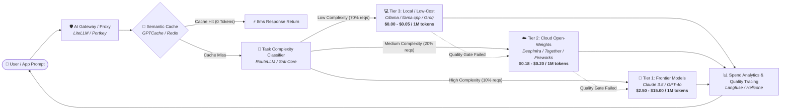

<p align="center">
  
</p>

# 🚀 Awesome Model Inference Cost Optimization [](https://github.com/ishandutta2007/Awesome-Awesome-Awesome)

<p align="center">
  <a href="https://github.com/ishandutta2007/Awesome-Awesome-Awesome"></a><a href="https://discord.gg/jc4xtF58Ve"></a>
  <a href="https://github.com/ishandutta2007/Awesome-Model-Inference-Cost-Optimization/stargazers"></a>
  <a href="https://github.com/ishandutta2007/Awesome-Model-Inference-Cost-Optimization/network/members"></a>
  <a href="https://github.com/ishandutta2007/Awesome-Model-Inference-Cost-Optimization/pulls"></a>
  <a href="https://github.com/ishandutta2007/Awesome-Model-Inference-Cost-Optimization/blob/main/LICENSE"></a>
  
  <a href="https://github.com/ishandutta2007"></a>
</p>

---

## 🎯 Overview & Mission

Welcome to the definitive curated directory of **Model Inference Cost Optimization** technologies. As AI systems scale into production, inference costs rapidly overtake model training budgets. This ecosystem catalog tracks the premier **SaaS platforms**, **AI gateways**, **intelligent model routers**, and **open-source serving runtimes** that slash token bills by **50% to 85%** without compromising generation quality.

Whether you are an AI platform engineer eliminating runaway token expenditures, an MLOps architect enforcing strict p95 latency SLAs, or a developer seeking high-throughput self-hosted inference, this guide covers the complete production stack.

### 💡 Key Value Drivers:
- **🔀 Intelligent Routing**: Direct simple queries to cheaper/smaller models and reserve frontier models for complex reasoning.
- **⚡ Cascade Fallbacks**: Multi-tier execution that tests fast low-cost models against quality gates before escalating.
- **💾 Semantic Caching**: Prevent redundant LLM calls by retrieving previously generated responses within cosine similarity thresholds.
- **🗜️ Prompt Compression**: Eliminate redundant context tokens using lexical and semantic compressors without sacrificing context.
- **🚀 High-Throughput Serving**: Exploit PagedAttention, continuous batching, speculative decoding, and quantization.

---

## 🧭 Sector Overview & Market Dynamics

The global AI inference market is projected to expand from **$32 billion in 2024 to over $215 billion by 2030**, representing more than **85% of total enterprise AI compute expenditure** as workloads shift decisively from training to real-time operations.

The model inference and cost-optimization sector is **moderately to highly fragmented rather than winner-take-all**. Because production workloads present vastly divergent trade-offs across latency tolerances, privacy and data sovereignty requirements, and hardware availability, no single vendor monopolizes the pipeline. Instead, enterprise AI stacks increasingly converge on a composable hybrid architecture: combining open-source local/private engines (e.g., vLLM, SGLang, Ollama) with multi-provider AI gateways (e.g., LiteLLM, Portkey) and dynamic routing engines that continuously arbitrage cost against real-time quality benchmarks.



---

## 📑 Table of Contents

- [🎯 Overview & Mission](#-overview--mission)
- [🧭 Sector Overview & Market Dynamics](#-sector-overview--market-dynamics)
- [🏢 SaaS & Hosted Inference Platforms](#-saas--hosted-inference-platforms)
- [💻 Open-Source Inference Infrastructure & Frameworks](#-open-source-inference-infrastructure--frameworks)
- [⚙️ Core Cost Reduction Strategies](#️-core-cost-reduction-strategies)
- [🤝 How to Contribute](#-how-to-contribute)
- [⭐ Star History](#-star-history)
- [💖 Support & Sponsoring](#-support--sponsoring)
- [📜 Disclaimer](#-disclaimer)

---

## 🏢 SaaS & Hosted Inference Platforms

The table below lists leading managed inference platforms and routing layers, sorted in **descending order by company valuation/revenue**.

| Platform | Company Size (Valuation / Revenue) | Specific Starting Tier Pricing | Specific Free Tier / Free Trial Limit | Core Optimization & Key Capabilities |
| :--- | :--- | :--- | :--- | :--- |
| **[Groq](https://groq.com/)** | **$2.8B Valuation** (Series D, $640M raised) | **$0.05 / 1M tokens** for Llama 3 8B; **$0.59 / 1M tokens** for Llama 3 70B | **Free Forever plan**: 30 requests/min, 14,400 requests/day, max 7,000 tokens/min limit (no credit card required) | Ultra-fast LPU (Language Processing Unit) architecture delivering 300–800+ tokens/sec, maximizing throughput-per-dollar for real-time applications. |
| **[Together AI](https://www.together.ai/)** | **$1.25B Valuation** (Series A/B, $230M+ raised; $50M+ ARR) | **$0.18 / 1M tokens** for Llama 3 8B; **$0.88 / 1M tokens** for Llama 3 70B; Dedicated GPU instances from **$1.00/hr** | **Free Trial**: **$5.00 in free API credits** on signup (valid for 90 days, no upfront credit card required) | FlashAttention-3 powered engine with customized inference kernels, fine-tuning infrastructure, and dedicated GPU cluster isolation. |
| **[Fireworks AI](https://fireworks.ai/)** | **$552M Valuation** (Series B, $77M total raised) | **$0.20 / 1M tokens** for ≤16B parameter models; **$0.90 / 1M tokens** for models >16B | **Free Trial**: **$1.00 in free API credits** upon signup (~5M tokens on 8B models, active across first 30 days) | Compound AI systems platform featuring speculative decoding, function calling, JSON schema acceleration, and fine-tuned LoRA serving. |
| **[Baseten](https://www.baseten.co/)** | **$250M+ Valuation** (Series B, $60M total raised) | **$0.20 / 1M tokens** for serverless models; dedicated custom serving from **$0.00036/sec** ($1.30/hr for A10G) | **Free Trial**: **$30.00 in free compute credits** valid for 30 days upon new workspace activation | Dedicated and autoscaling serverless model serving with Truss open-source packaging, sub-second cold starts, and multi-cloud GPU deployments. |
| **[FriendliAI](https://friendli.ai/)** | **$60M+ Valuation** (Series A, $18.5M total raised) | **$0.20 / 1M tokens** for Friendli Serverless 8B models; Dedicated endpoints from **$0.80/hour** | **Free Trial**: **$5.00 in free API credit allowance** valid for 30 days upon email verification | Patented iteration-level scheduling (Orca engine) achieving industry-leading GPU utilization, continuous batching, and low TTFT. |
| **[Martian](https://withmartian.com/)** | **$40M–$50M Valuation** (Seed, $9M raised) | **0% markup** over upstream provider token pricing + **$0.0000002/query** router orchestration fee | **Free Trial**: **$10.00 in free routing balance** on developer account creation (no expiration date) | Dynamic Model Router that unpacks prompts and routes to the highest-ROI model per individual prompt, avoiding overpaying for simple queries. |
| **[Portkey](https://portkey.ai/)** | **$15M–$20M Valuation** (Seed, $3M raised; 480B+ tokens routed) | **$49.00/month** Pro plan (includes 10M routed gateway requests + $5/10M additional requests) | **Free Forever Developer Plan**: Up to 10,000 requests/day, 2 seats, unlimited model routing, retries, and basic logging | AI Gateway with integrated guardrails, semantic caching, automated retries with exponential backoff, virtual keys, and multi-model fallbacks. |
| **[OpenRouter](https://openrouter.ai/)** | **~$10M–$15M ARR** (Profitable / Bootstrapped & Seed) | **$0 platform fee markup**; provider rates starting at **$0.05 / 1M tokens** (Llama 3 8B) & **$0.14 / 1M tokens** (DeepSeek-V3) | **Free Forever Tier**: Access to 10+ free models (e.g., `meta-llama/llama-3-8b-instruct:free`) at 20–50 requests/min rate limit | Unified OpenAI-compatible API gateway aggregating 300+ models from 30+ providers with automatic failover, best-price routing, and usage quotas. |
| **[DeepInfra](https://deepinfra.com/)** | **~$10M Est. Valuation / ARR** (Seed funded) | **$0.055 / 1M input tokens** and **$0.055 / 1M output tokens** for Llama 3 8B; **$0.25 / 1M tokens** for Llama 3 70B | **Free Trial**: **$1.80 free balance** / 1 hour of free serverless GPU compute upon initial signup | Pay-per-token serverless inference with ultra-competitive pricing for open-weight models, embeddings, Whisper audio, and image models. |

---

## 💻 Open-Source Inference Infrastructure & Frameworks

Open-source tools give engineering teams full control over model weights, private VPC hosting, and custom routing logic. Below are the premier open-source repositories, sorted in **descending order by GitHub Stars_Count**.

1. **[Ollama](https://github.com/ollama/ollama)** [](https://github.com/ollama/ollama/stargazers)  
   *Get up and running with Llama 3, Mistral, Gemma, and DeepSeek locally.*  
   The definitive local runtime for developer environments and Tier-3 cascade routing. Eliminates external API costs by serving quantized models locally on Apple Silicon, AMD, and NVIDIA hardware with zero external dependencies.

2. **[llama.cpp](https://github.com/ggerganov/llama.cpp)** [](https://github.com/ggerganov/llama.cpp/stargazers)  
   *LLM inference in C/C++ with minimal memory footprint.*  
   Pioneered 2-bit, 4-bit, 5-bit, 6-bit, and 8-bit integer quantization (GGUF). Runs large models on consumer CPUs, Apple unified memory, and mixed GPU hardware, radically lowering the hardware barrier for inference.

3. **[vLLM](https://github.com/vllm-project/vllm)** [](https://github.com/vllm-project/vllm/stargazers)  
   *A high-throughput and memory-efficient LLM serving engine.*  
   Invented **PagedAttention** to virtually eliminate KV cache memory fragmentation. Delivers continuous batching, chunked prefill, FP8/FP4 quantization, and speculative decoding. Achieves ~$0.20/1M tokens on 4×H100 clusters.

4. **[LiteLLM](https://github.com/BerriAI/litellm)** [](https://github.com/BerriAI/litellm/stargazers)  
   *Unified OpenAI-compatible proxy gateway for 100+ LLM APIs.*  
   Provides virtual API keys, team-based budget caps, spend tracking, dynamic load balancing, cross-provider fallbacks, and semantic caching. Delivers an ultra-lean 8ms P95 latency overhead at 1,000 RPS.

5. **[SGLang](https://github.com/sgl-project/sglang)** [](https://github.com/sgl-project/sglang/stargazers)  
   *Fast serving framework for large language models and vision-language models.*  
   Introduces **RadixAttention** for automatic KV cache reuse across complex multi-turn chats, agent loops, few-shot templates, and structured JSON decoding. Speeds up complex prompt workflows by 3x–5x.

6. **[Langfuse](https://github.com/langfuse/langfuse)** [](https://github.com/langfuse/langfuse/stargazers)  
   *Open-source LLM engineering platform for observability, tracing, and token cost attribution.*  
   Pinpoints expensive prompts, tracks token consumption per user/feature, provides latency breakdown, and monitors model drift across deployments.

7. **[TensorRT-LLM](https://github.com/NVIDIA/TensorRT-LLM)** [](https://github.com/NVIDIA/TensorRT-LLM/stargazers)  
   *NVIDIA's compiler and runtime for peak LLM inference on NVIDIA GPUs.*  
   Leverages custom fused multi-head attention kernels, FP8 execution on Hopper/Blackwell, in-flight batching, and tensor parallelism to deliver the lowest cost-per-token on enterprise NVIDIA hardware.

8. **[Portkey Gateway](https://github.com/Portkey-AI/gateway)** [](https://github.com/Portkey-AI/gateway/stargazers)  
   *Ultra-fast, production-grade AI gateway engine in TypeScript.*  
   Processes requests with sub-millisecond overhead. Offers automated retries with backoff, canary deployments, model fallback trees, custom load-balancing heuristics, and plugin guardrails.

9. **[Triton Inference Server](https://github.com/triton-inference-server/server)** [](https://github.com/triton-inference-server/server/stargazers)  
   *Multi-framework, enterprise-grade AI model serving platform.*  
   Maximizes GPU utilization across simultaneous heterogeneous models (LLMs, vision, embedding, tabular) with dynamic batching, model pipelining, and concurrent model execution.

10. **[Text Generation Inference (TGI)](https://github.com/huggingface/text-generation-inference)** [](https://github.com/huggingface/text-generation-inference/stargazers)  
    *Hugging Face's purpose-built toolkit for deploying LLMs in production.*  
    Features tensor parallelism, token streaming, continuous batching, watermarking, optimized FlashAttention-2 kernels, and native safetensors weight loading.

11. **[Xinference](https://github.com/xorbitsai/inference)** [](https://github.com/xorbitsai/inference/stargazers)  
    *Distributed inference library for LLMs, speech recognition, and multimodal architectures.*  
    Automates multi-node GPU cluster allocation, model migration, and dynamic replica scaling to curtail idle cloud GPU expenses.

12. **[GPTCache](https://github.com/zilliztech/GPTCache)** [](https://github.com/zilliztech/GPTCache/stargazers)  
    *Semantic cache framework to reduce LLM query costs and latency.*  
    Vectorizes prompt queries and retrieves cached outputs for semantically identical questions, cutting upstream LLM API bills by 40%–80% for repetitive customer workloads.

13. **[LLMLingua](https://github.com/microsoft/LLMLingua)** [](https://github.com/microsoft/LLMLingua/stargazers)  
    *Prompt compression library developed by Microsoft Research.*  
    Compacts prompt tokens by up to 20x using small language model perplexity scoring with minimal quality degradation, dramatically slashing prompt input token costs in long-context and RAG tasks.

14. **[Helicone](https://github.com/Helicone/helicone)** [](https://github.com/Helicone/helicone/stargazers)  
    *Open-source LLM observability platform with integrated proxy.*  
    Provides one-line integration for prompt caching, customer rate limiting, anomaly and cost spike alerts, and detailed token-level financial accounting.

15. **[RouteLLM](https://github.com/lm-sys/RouteLLM)** [](https://github.com/lm-sys/RouteLLM/stargazers)  
    *LMSYS framework for cost-effective routing between strong and weak models.*  
    Reduces API costs by 2x+ with zero loss in benchmark scores (MT-Bench) by dynamically routing prompts between weak (cheap) and strong (frontier) models using matrix factorization and BERT classifiers.

16. **[LoRAX](https://github.com/predibase/lorax)** [](https://github.com/predibase/lorax/stargazers)  
    *Multi-LoRA inference server designed by Predibase.*  
    Serves hundreds of task-specialized fine-tuned LoRA adapters on a single GPU base model instance simultaneously, eliminating the prohibitive expense of dedicated model instances.

17. **[Sriti Core](https://github.com/sriti-ai/sriti-core)** [](https://github.com/sriti-ai/sriti-core/stargazers)  
    *Intelligent, reliability-aware multi-tier cascade routing engine.*  
    Routes tasks across Tier 3 (local Ollama), Tier 2 (cloud open-weights), and Tier 1 (frontier models) using in-process ONNX classifiers, encrypted semantic caching, prompt compression, and automated quality gates.

18. **[Chimeraforge](https://github.com/Sahil170595/Chimeraforge)** [](https://github.com/Sahil170595/Chimeraforge/stargazers)  
    *Model selection, deployment planning, and benchmarking toolkit.*  
    Evaluates candidate models against specific hardware and budget constraints, benchmarking live throughput, TTFT, and quality metrics (BERTScore, ROUGE-L) to find optimal price-performance configurations.

---

## ⚙️ Core Cost Reduction Strategies

Combining these architectural pillars enables production teams to achieve compound savings:

```
Total Savings = (Semantic Cache Hit Rate × 100%) + (Routed Cheap Model % × 80%) + (Compressed Tokens × 40%)
```

1. **🔀 Prompt Complexity Classification**:
   Over 60%–75% of user queries in enterprise applications do not require frontier reasoning models ($15/1M tokens). Small ONNX classification or embedding-distance classifiers route simple extractive tasks to $0.05/1M token models.

2. **💾 Semantic & Exact KV Caching**:
   Storing responses indexed by prompt embeddings in high-speed stores (Redis, Valkey, Milvus) allows instant 0-cost returns for repeated or paraphrased user prompts.

3. **🗜️ Context Pruning & Compression**:
   Tools like LLMLingua-2 strip redundant filler tokens, whitespace, and non-essential tokens from retrieved RAG passages before passing them to the generator.

4. **⚡ Continuous Batching & Memory Paging**:
   Engines like vLLM and SGLang group incoming requests dynamically at the token iteration level, boosting GPU utilization from ~20% to >85% and cutting self-hosted hardware costs.

5. **🎯 Quantization & Adapter Multiplexing**:
   Deploying FP8 or INT4 models reduces VRAM requirements by 50%–75%, allowing larger models to fit into a single GPU. Multi-adapter serving (LoRAX) allows diverse specialized tasks to share one base model cluster.

---

## 🤝 How to Contribute

Contributions are warmly welcomed! Help keep this directory current, accurate, and valuable for the entire AI community:

1. 🍴 **Fork the repository**.
2. ✍️ **Add or update an entry** in `README.md`:
   - Follow the established table or list format.
   - For SaaS tools: provide specific starting prices, specific free tier limits, and company size/funding.
   - For Open-Source tools: include official GitHub repo link and `style=social` Stars_Badge.
3. 🧪 Ensure all links and markdown formatting render properly.
4. 🚀 **Submit a Pull Request** with a concise description of your changes.

---

## ⭐ Star History

[](https://star-history.dera.page/#ishandutta2007/Awesome-Model-Inference-Cost-Optimization&type=date&legend=top-left)

---

## 💖 Support & Sponsoring

Thank you for visiting and supporting **Awesome-Model-Inference-Cost-Optimization**! 🙏

If this curated repository has helped you save infrastructure budget, optimize inference latency, or architect production AI systems:

- ⭐ **Star this repository** on GitHub to help other engineers discover it.
- 🍴 **Fork and contribute** your favorite optimization techniques, routers, or benchmarks.
- 📢 **Share** with your engineering team, MLOps groups, and AI developer communities.
- ☕ **Support the maintainer** or sponsor future development via the [GitHub Sponsor Dashboard](https://github.com/sponsors/ishandutta2007):

<p align="center">
  <a href="https://github.com/sponsors/ishandutta2007">
    
  </a>
</p>

---

## 📜 Disclaimer

- This is an independent, **community-curated directory** provided for educational and architectural reference.
- Pricing, free tier limits, and vendor features change frequently. Always confirm current rates with upstream providers before deploying critical workloads.
- Dynamic routing and model cascading affect output quality. Ensure appropriate quality gates, automated evals, and fallback policies are configured for your domain.

---

<p align="center">
  <b>Built with ❤️ for AI Engineers, MLOps Architects, and High-Scale Infrastructure Teams.</b>
</p>
